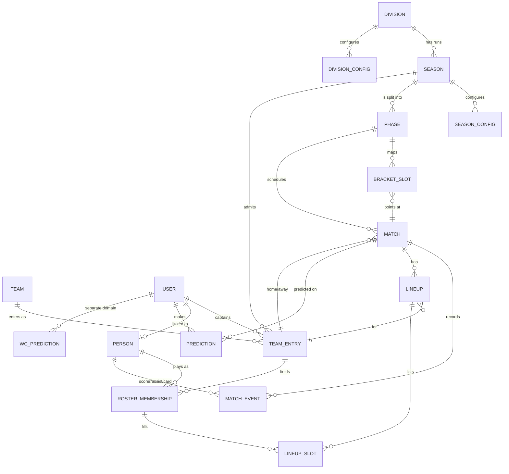

# SL-002 — Domain glossary and relationship model

**Status:** Approved by owner 2026-11-16 (Phase 0 decision record). Names here are normative for new schema, APIs, UI, routes, tests, and docs.

## Domain requirement: division-agnostic (owner decision 2026-11-16)

1. A dictator creates, configures, archives, and orders divisions from the dashboard. Adding a division requires **no code change, no enum/check-constraint change, no new route or table, and no new migration**.
2. Each division has any number of seasons. Each division and season carries its own enabled features/sections, rules, branding, registration settings, and format (league, knockout, or combined).
3. Seed/legacy values are not special: Men's, Women's, and Freshers are ordinary division records created by migration/seed. **Inter has not started; there is no Inter data.** No Inter division is created to represent the legacy `inter` value. A dictator can create Inter later exactly like any other division.
4. Roles, RLS, APIs, and UI key on division/season IDs, never on division names.

## Glossary

| Term | Meaning |
|---|---|
| **Division** | The formal, long-lived competition identity (e.g. Men's, Women's, Freshers, and any a dictator creates later such as Inter or Pradhva). A **data record**, never a code enum or route branch. Replaces the legacy free-text `division` strings. Not the same as a season. |
| **Season** | One run of a division (e.g. "2026"). Owns its teams' participation, phases, matches, standings, fantasy, and configuration. |
| **Division configuration** | Dictator-managed settings per division and per season: enabled sections, rules text, format, home presentation, share copy. Data, not code branches. |
| **Phase** | A stage within a season: `league`, `knockout`, or combined. Holds format rules. |
| **Bracket slot** | An explicit, editable mapping of a knockout position to a match (or to a source slot). |
| **Team** | A named club identity (name, logo, colour). Per-division/season participation is a **team entry**. |
| **Team entry** | A team's participation in one season; carries the assigned captain. |
| **Person / player identity** | One account-linked identity reused across divisions and seasons; holds profile and FUT data. |
| **Roster membership** | A person's participation on a team entry for one season (position, jersey, rating for that season). |
| **Match** | A fixture within a season/phase between two team entries. |
| **Match event** | A goal, own goal, assist attribution, or card, with minute. The single source of truth for score/stats derivation (rule for manual score override is an open Phase 2 item, backlog §5). |
| **Lineup** | A team entry's chosen starters/positions for a match, chosen from existing roster members only. |
| **User / account** | A Supabase Auth user with a profile and a product role: user, captain, scorer, editor, or dictator (see SL-003). |
| **Prediction** | A user's division-fantasy pick for a match in a season. |
| **World Cup fantasy** | A separate domain (`wc_*`) with its own page and rules. Shares only account/auth primitives; no division/season FKs. |
| **Edition** | Retired term. Do not use; say "season". |

## Relationship diagram

## Current names → target names (feeds SL-004 map)

`teams.division` / `matches.division` / `team_registrations.division` / `polls.division` → `division_id` (+ `season_id` where run-specific). `players` + `team_members` → person + roster membership. `goals` + `matches.scorers/assists/own_goals` → match events. `user_profiles.*_team_flair` → per-division fantasy profile; `wc_team_flair` → World Cup profile.

## Implemented (2026-11-19)

Migration `20261119000000_divisions_and_seasons.sql` creates `divisions`, `seasons` (several per division, at most one `is_current`), `section_types` and `season_sections` (the season's sections: enabled, navigation, order, settings), and `team_entries` (a team in a season). `matches.season_id` and `team_registrations.season_id` replace the legacy strings, which were retired in `20261122000000` together with the per-division flair columns (now `division_flairs`) and the division-string views (now `season_player_stats`). Mapping, naming and the compatibility rules are in `D-01-division-season-mapping.md`. Rosters (`players.team_entry_id`) and fantasy points (`season_fantasy_points`) are per season too; see the Season or division table in `D-01-division-season-mapping.md`. Hidden or archived (`visibility`, `archived_at`) is separate from deletion, which foreign keys refuse once a season has data.
